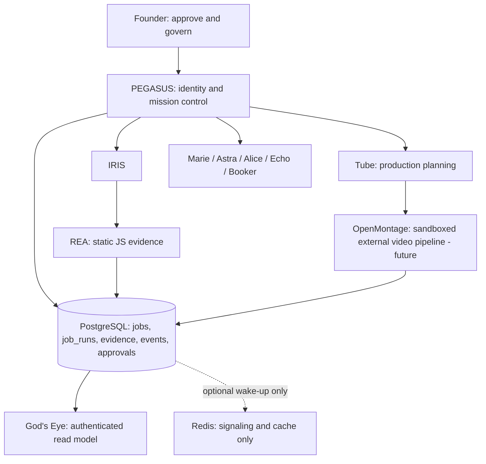

# Pegasus capability fabric + OpenMontage (lab architecture checkpoint)

**Date:** 2026-10-13
**Branch:** `feature/pegasus-capability-bus-20261013` based on `dbdcf1b`.
**Approval:** Development contract and synthetic evidence acceptance ONLY.
**Execution:** No external systems, renderer, Redis server, production DB, paid models, patient data, videos or billing invoked.

## Uploaded OpenMontage source review

Source: user-uploaded `OpenMontage-main (2).zip`. SHA-256: `540d18a36dae64b1b8f8fdff56108719a73e29da7bdd564dd59bbf60c586f757`. 2,633 archive entries. Repository identifies AGPL-3.0 licensing; treat distributed and network-hosted derivative use as requiring proper license review.

- OpenMontage is **not** an always-on multi-agent server in the conventional sense. `docs/ARCHITECTURE.md` says an external coding agent orchestrates manifests and Python tools and writes checkpoints. There is no Python runtime orchestrator provided for arbitrary autonomous jobs.
- `pipeline_defs/screen-demo.yaml`: production stable pipeline; `idea -> script -> scene_plan -> assets -> edit -> compose -> publish`. Supports real app screen capture and deterministic Remotion synthetic terminal scenes.
- `pipeline_defs/animated-explainer.yaml`: begins `research -> proposal`, then script/scene/assets/edit/compose/publish. Budget and approval gates exist in manifests.
- `pipeline_defs/podcast-repurpose.yaml`: beta; begins `idea -> script` and needs a source audio/video asset for real production.
- `backlot/README.md`: read-only production storyboard uses checkpoint files under `projects/<id>`, `events.jsonl` and media assets with server-sent events to the browser.
- `remotion-composer/package.json`: separate React/Remotion 4 composition toolchain. No generation/renderer installed or invoked by this Pegasus change.
- `lib/events.py` says observed tool events are **best-effort** and may be dropped. Never rely on OpenMontage JSONL activity as a financial audit log or durable task completion event.

## Authority map

Production authority always stays with Pegasus, backed by PostgreSQL. Redis is not the system of record; messages are hints only. A future transactional-outbox worker must publish verified PostgreSQL event IDs to Redis with idempotent consumption and replay, and the consumer must reload the authoritative DB row. No Redis publish/subscribe service has been activated.

## What was implemented

- `core/integrations/pegasusCapabilityFabric.ts`:
  - Typed registry of owned and optional components and preliminary licensing/readiness boundaries.
  - `planTubeMontage`: accepts only the three studied OpenMontage pipelines, UUIDs, Tube owner, synthetic data and `budgetUsd:0`; denies unrecognized fields, media paths, credentials, external actions, publication and launch.
  - Pipeline-specific first stage based on the real manifests (animated explainer starts at `research`).
  - `reaReviewSignal`: transforms a review-required synthetic REA finding into provenance-marked metadata only.
  - `tubeStoryboardSignal`: transforms a synthetic plan into a pending-review signal. **No video is created or rendered.**
  - `buildGodsEyeLabSnapshot`: validates and orders the signals, labels them `synthetic_lab_only` and `human_review_required`. Does **not** claim actual agent decisions or company revenue.
  - `makeRedisWakeupHint`: constructs `transportStatus:'not_published'` and requires PostgreSQL durable truth. **Does not contact Redis.**
- `core/integrations/capabilityRegistry.ts`: browser-safe static capability metadata shared by the lab fabric and UI (no secrets or health assertions).
- `src/components/GodsEyeLabDashboard.tsx`: premium dark prototype visualizing capability family and honest readiness; no customer data or fabricated live jobs.
- `src/App.tsx`: new dev route `/?gods-eye-lab=1` for the static lab view only; it does not connect to data services.
- `tests/pegasus-capability-fabric.test.ts`: registry contracts, stage choices, non-execution, forbidden data classes, strict provenance, duplicates and fabricated states.
- `tests/pegasus-capability-real-evidence-acceptance.ts`: manually connects real prior REA-generated source analysis evidence from the isolated KINGDOM REA lab, a synthetic Tube plan and a God's Eye laboratory snapshot. It performs no network calls or side effects.

## Resource and launch gates

- KINGDOM observed approximately **951,340 KiB free physical RAM** on 2026-10-13. Redis service binary and process not found, while Docker Desktop processes exist; that does not prove Docker Engine is healthy. Avoid further servers, local image generators or renderers until memory/OS isolation is resolved.
- OpenClaw requires a compatible isolated Node version and explicit permission controls; remains not enabled.
- OpenMontage's backlot, Python tools, Remotion and provider dependencies are **not installed**, not configured and not granted access to business systems. Real renders may require paid providers, GPU/CPU resources or third-party tools. An upstream `budget_default_usd` is not a Pegasus approval.
- n8n and Dify licensing must be assessed before resale, customer-facing hosting or distribution; keep as optional internal adapters.
- Astra isolated database acceptance remains pending from earlier connection restrictions. Don't bypass.
- The current lab snapshot is purely an in-memory read model, not an authenticated deployed endpoint and not durable evidence.

## Next phased build

1. **Real, durable God's Eye read path:** authenticate and authorize founder access; fetch permitted Pegasus PostgreSQL `events`, `jobs`, `job_runs` and evidence with filtered fields and pagination. Confirm it cannot mark jobs complete or expose secrets. Add OpenTelemetry trace IDs as an additive observation field.
2. **Replay-safe signaling:** create a PostgreSQL transactional outbox migration and idempotent disposable Redis delivery worker in an isolated database; run duplicate/crash/reconnect tests before involving real agents. With less than 1 GB free RAM, test against a remote/isolated Redis instance or delay the server.
3. **Tube video studio:** begin with one owned, synthetic `screen-demo` storyboard and local no-provider composition after separate process isolation, resource checks and license approval. Ingest OpenMontage checkpoints into a review-only Pegasus task; forbid publish.
4. **IRIS -> REA -> Alice -> Simon:** register review-only evidence envelopes and authenticated transitions, test actual QA in staging using Playwright; no unapproved edits or production promotion.
5. **Revenue integrations last:** expand CRM/calendar/checkout with explicit permissions, verified sender identity, idempotency, reconciled transactions and founder controls.

## Source of truth

This checkpoint is a tested **proposal and offline acceptance**, not production deployment. Preserve all agent brains, voices and existing Huddle behavior. No GitHub push, domain promotion or production migration is implied.
